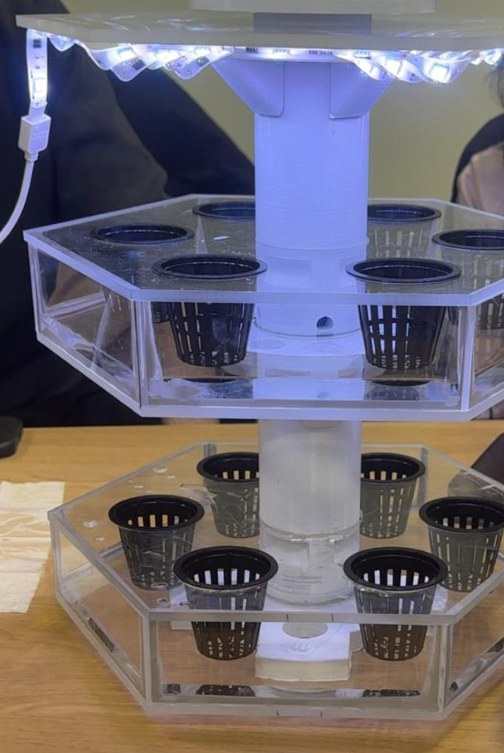
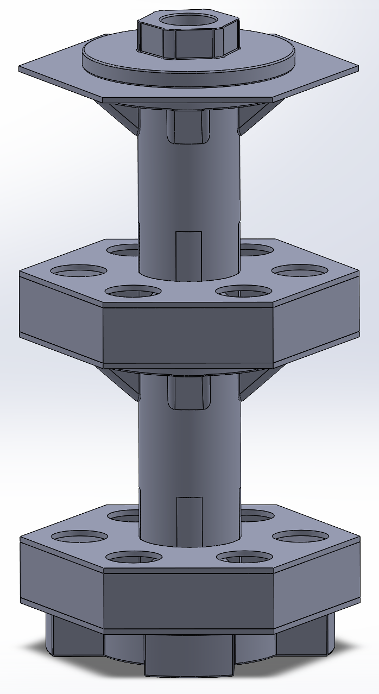
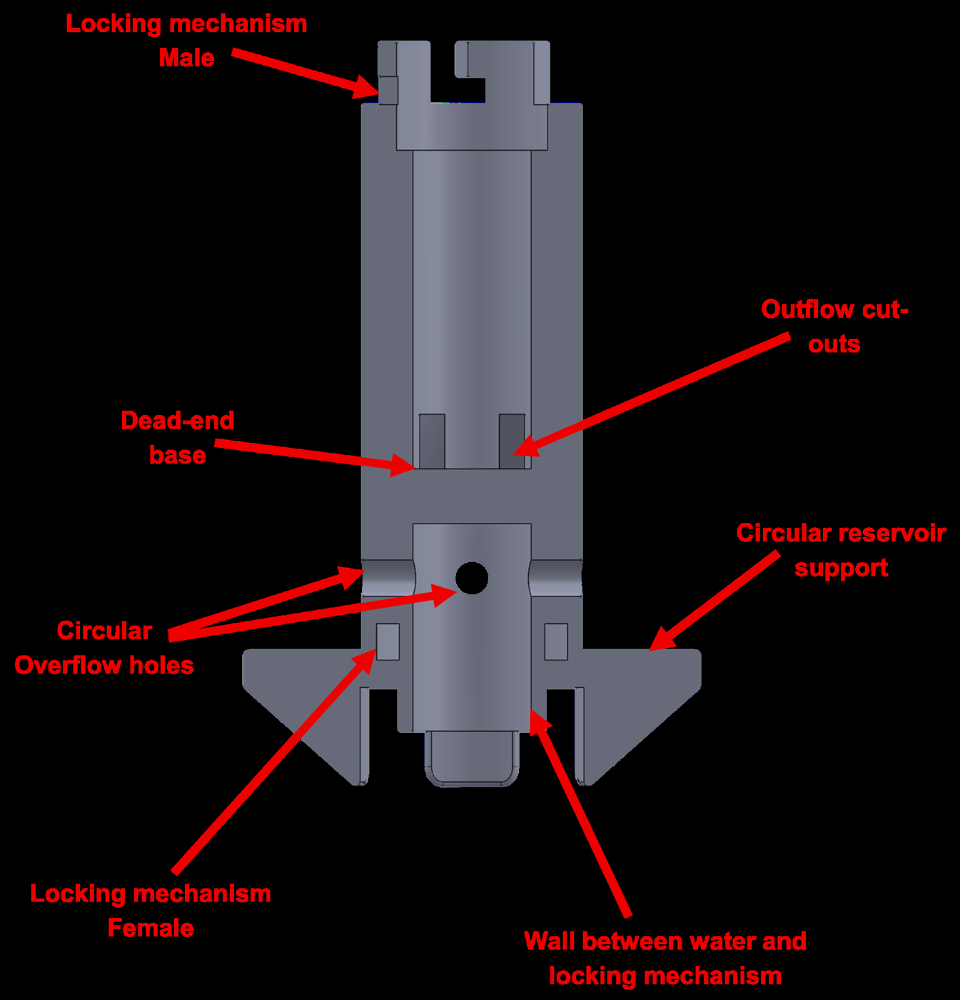
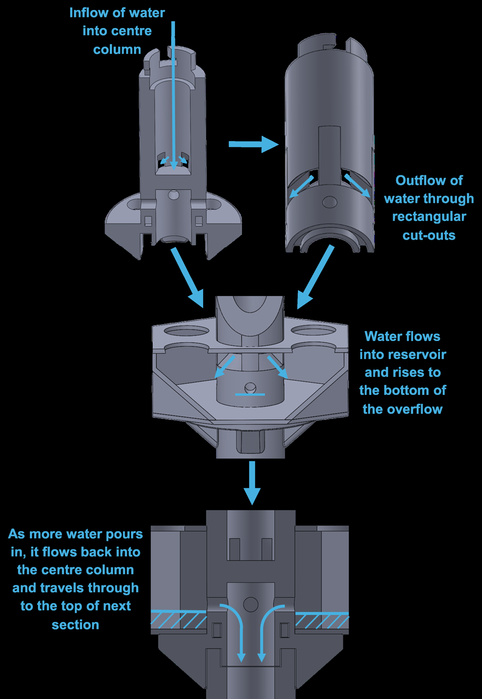
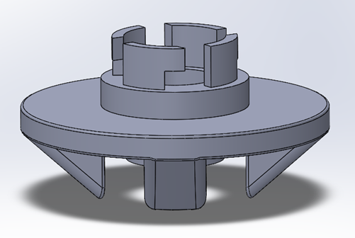
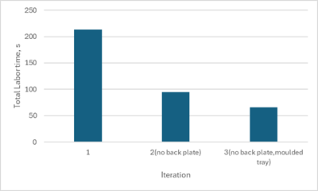
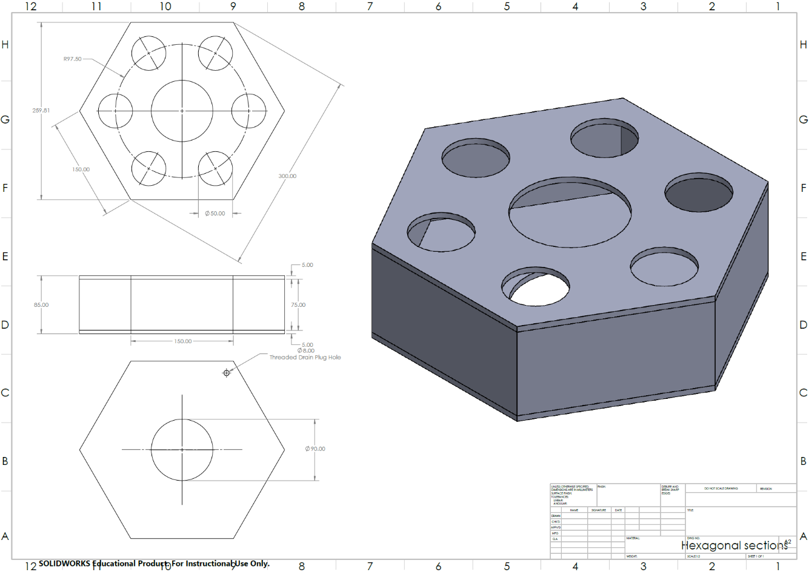
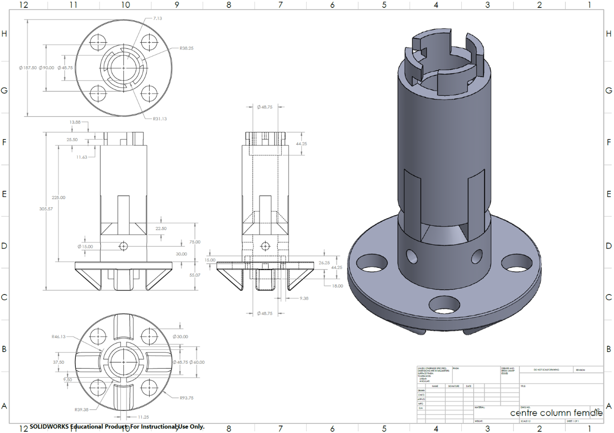

# Modular Kratky Hydroponic System: Product Design & DFMA

**Cardiff University, EN3906 Product Design: group project (team of 7), 2026**

This is a **stackable, pump-free home hydroponics unit**. Hexagonal acrylic reservoirs sit on a 3D-printed central column that spreads nutrient water to every layer by gravity alone. We designed it in SolidWorks, built a working prototype for **£185**, and optimised it with Boothroyd-Dewhurst **DFMA**, which cut assembly time by **69 %**.

 

---

## The problem

Voice of the Customer research found three pain points with home hydroponics: managing nutrient levels, energy use, and maintaining pumps and circulation systems. Our concept uses the **Kratky method**: plants hang above a still nutrient reservoir, and as the water level drops, an air gap forms that oxygenates the roots. No pumps, no aeration and no electricity are needed apart from the grow light.

We picked the final concept (a hexagonal layered design with a central support) using a **QFD matrix** scoring cost, ease of use, aesthetics, maintenance and environmental impact.

## Design

**Hexagonal layers.** They tessellate in a honeycomb pattern, so several units sit side by side with no wasted space. They also look less industrial in a home.

**Gravity-fed central column.** Water poured in at the top runs down the hollow column and fills each reservoir through four rectangular outlets cut at −45°. When a reservoir reaches its overflow level (8 mm above the tray base, just covering the plant pots), the excess drops to the next layer. The bottom layer drains into a drip tray, and each tray has an M8 nylon drain plug.

| Column cross-section | Water flow path |
|---|---|
|  |  |

**Twist-lock "lock and key" joints.** Every column section uses the same bayonet-style lock, so the unit can be stacked to any height. The lock sits behind a wall, away from the water path, to prevent leaks.

**Materials**
- **Trays:** water-jet-cut acrylic (PMMA). Transparent, rigid and resistant to nutrient solutions.
- **Column:** FDM-printed PLA. Middle sections at 40 % infill to carry about 2 kg of water each (found by test prints); top sections at 20 %.
- **Seals and plugs:** food-safe silicone sealant and nylon drain plugs.

**Trade-offs we weighed:** acrylic vs HDPE trays, silicone bonding vs gaskets, a passive vs pumped system, printed PLA vs moulded polypropylene, and stackable vs fixed height.

## DFMA

### Design for assembly (Boothroyd-Dewhurst)

| Iteration | Change | Assembly time | DFA index |
|---|---|---|---|
| 1 | Initial: screwed structural back panels | 213 s | 6.56 |
| 2 | Prototype: back panels and 8 fasteners removed | 94 s (−55 %) | n/a |
| 3 | Optimised: single moulded tray replaces the walls and 6 bonding operations | **65 s (−69 % overall)** | **21.3** |

### Design for manufacture: cost (DFM Concurrent Costing)

| Component | Qty | Process (DFM CC) | Unit ($) | Total ($) |
|---|---|---|---|---|
| Hex plate with holes | 2 | Thermoforming + water-jet trim | 67.12 | 134.24 |
| Hex plate, plain + drain | 3 | Thermoforming + water-jet trim + drill/tap | 53.73 | 161.19 |
| Wall panels | 12 | Machined from stock | 24.03 | 288.36 |
| Water-flow cylinder | 2 | Structural foam moulding (stand-in for 3D printing) | 58.06 | 116.12 |
| Base holder | 4 | Structural foam moulding (stand-in for 3D printing) | 26.00 | 104.00 |
| Net pots + LED strip | 13 | Purchased | n/a | 33.00 |
| **Total** | | | | **836.91** |

The estimate (about £660) is far above the **£185 actual build cost** because DFM CC spreads setup cost over just 2–12 parts and uses US labour rates. Above 10,000 units, hex plates fall to about $3–5 each. The biggest saving the cost-reduction guide identified is **merging the two hex plate designs into one universal plate**, which matches the DFA finding that part consolidation matters most.

## Drawings

| Hexagonal tray | Centre column |
|---|---|
|  |  |

## Next steps
- Run FEA and physical load tests on the column under the 2 kg loaded reservoirs
- Run plant growth trials, and add UV strips under every layer
- Add water level and nutrient sensors
- Move to production processes: injection-moulded column and thermoformed trays

## Skills demonstrated
Product design process (VOC, QFD, concept selection) · SolidWorks modelling and drawings · 3D printing and prototyping · material selection · DFMA (Boothroyd-Dewhurst DFA, DFM Concurrent Costing) · teamwork

---
*Group project by Group 10, EN3906 Product Design, Cardiff University. This repository is my summary of our work.*
**Adarsh Vinod Nair**, BEng Mechanical Engineering, Cardiff University
